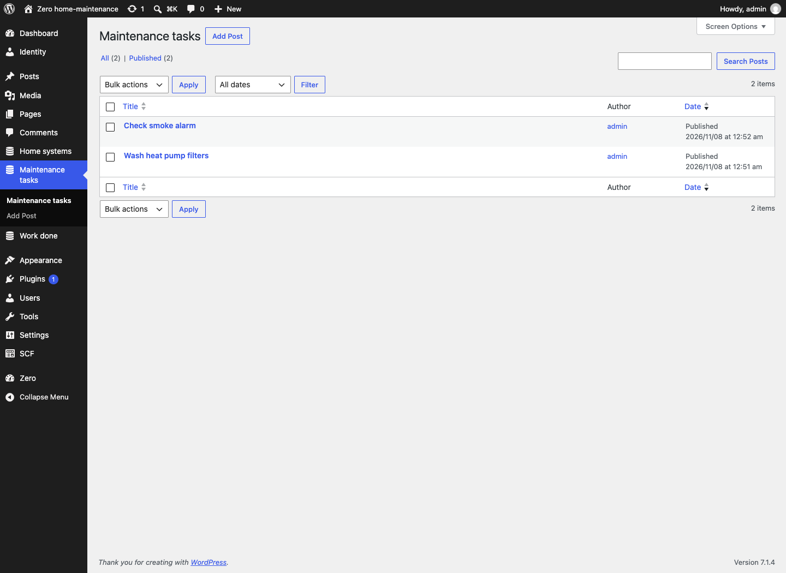
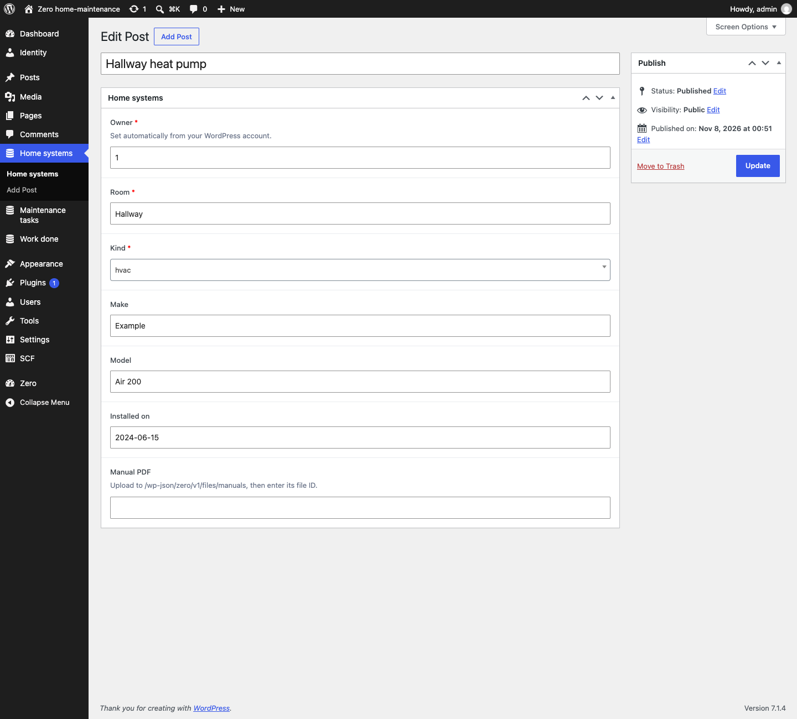
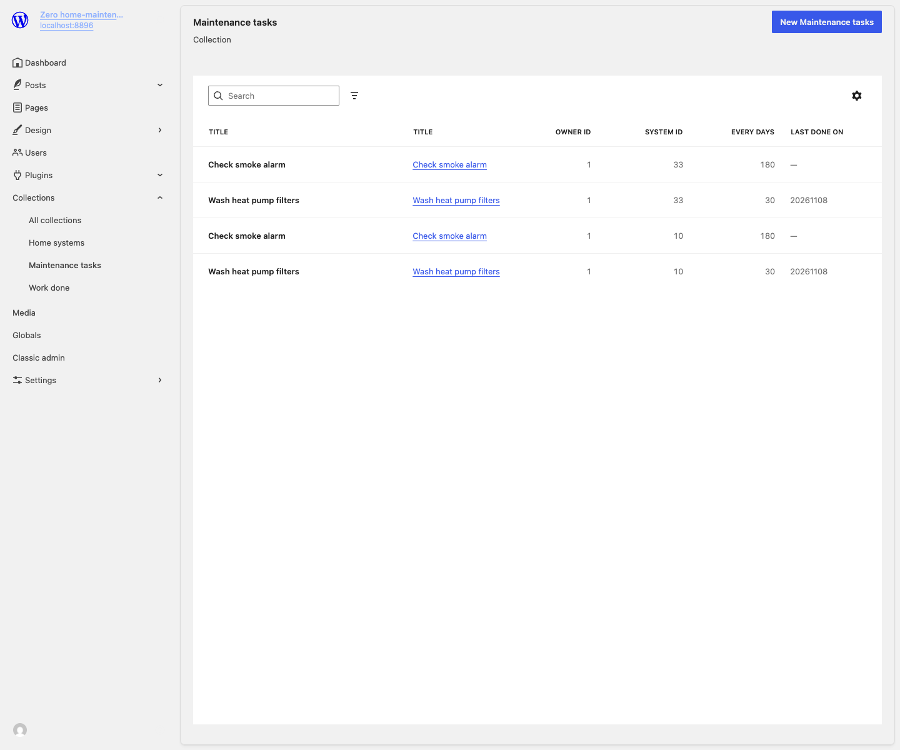

# Home maintenance

Keep a private maintenance log for the systems in your house. Use WordPress
admin, Secure Custom Fields, and [Zero Admin](../../docs/admin.md). There is no
custom frontend.

Each WordPress user owns their systems, recurring tasks, and work logs. Owner
filters apply to lists, edits, REST requests, and agent abilities. Hooks set
`ownerId` from the signed-in account and preserve it on updates. Even another
administrator cannot read your rows through the app.

## Run locally

From the repository root:

```sh
cargo build --locked --bin zero
./target/debug/zero build examples/home-maintenance
./target/debug/zero check examples/home-maintenance --json
tsc -p examples/home-maintenance
./target/debug/zero dev examples/home-maintenance --port 8896 --no-watch
```

Open `http://localhost:8896/wp-admin/` or `http://localhost:8896/zero-admin/`.
The disposable Studio account is `admin` with password `zero-test-admin`.
Studio activates the generated artifact, including Secure Custom Fields,
Action Scheduler, MCP Adapter, Zero Identity, and Zero Admin.

On the tested main revision, the native new-system form blocks creation on
the automatic Owner field. The HTTP verification script seeds the screenshot
data. A complete wp-admin-only creation workflow is not working yet; see
the exact validation error under known gaps.

Create a home system first, then a task referencing that system. Enter rich
instructions in the task editor. Use `markDone` through REST or your agent to
record completion and schedule the next visit. Open the resulting work log to
attach a photo using the standard media picker.

The committed `zero/client/`, `zero/_generated/migrations/`, `zero.gen.ts`, and plugin
lock are generated by `zero build`. Keep them with your config changes.

## Admin screens

These screenshots come from the local Studio site with sample data.

WordPress task list:



System edit screen with Secure Custom Fields:



Zero Admin task list:



## Data and actions

| Resource | Fields |
| --- | --- |
| `systems` | Name, room, kind, make, model, installation date, private PDF manual |
| `tasks` | System, title, repeat interval in days, last completion, next due date, rich instructions, overdue stamp |
| `doneLogs` | Task, completion date, notes, integer cost in cents, photo, original system snapshot |

Kinds are `hvac`, `plumbing`, `electrical`, `appliance`, and `safety`.
All dates and scheduling use UTC. Keep costs in one currency for a given home.
Ordinary WordPress media URLs are public on an unrestricted host. Keep a hosted
Space restricted when you attach personal photos.

| Action | Input | Result |
| --- | --- | --- |
| `dueNext` | `days`, default 30 | Your tasks with `nextDueOn <= UTC today + days`, ordered by due date, including overdue tasks |
| `markDone` | `taskId`, optional `notes`, optional `costCents` | A work log and updated task, committed together |
| `yearCost` | `year` | Costs per system, including zero-cost systems, and the total |

`markDone` sets `lastDoneOn` to today, calculates `nextDueOn = today + everyDays`,
and clears `overdueAt`. Omitted cost is zero. Send an `Idempotency-Key` header
when retrying the same completion request. Reusing that key returns the same log.

`yearCost` sums `costCents` for logs owned by the caller with
`year-01-01 <= doneOn < (year + 1)-01-01`, grouped by the log's saved `systemId`.
Changing a task's system later does not move previous spending. Creating or
editing a work log directly records history; use `markDone` to advance a task.

### Overdue stamps

Creating a task, or changing its next due date, enqueues `flagOverdue` using the
stock `job()` API. Its delay is the number of seconds until UTC midnight after
the due day, with a minimum of zero. Action Scheduler delivers the job after
the task write commits. The job checks the current owner, due date, and stamp
before writing `overdueAt`. A queued job for an old due date does nothing after
you reschedule the task. There is no custom cron or recurring worker.

On a WordPress host, keep Action Scheduler running through its normal host
integration. To deliver currently due jobs locally:

```sh
./target/debug/zero wp --site examples/home-maintenance action-scheduler run --hooks=zero_job --force
```

### Private manuals

The `manuals` resource accepts PDF files up to 20,000,000 bytes. Its read and
delete rules are `owner`, meaning the uploader. Downloads use signed links
that expire after five minutes. The SCF field accepts a private file ID.
Upload through Zero's authenticated file endpoint, then paste that ID into
**Manual PDF**:

```sh
curl --fail-with-body --user "$ZERO_APP_PASSWORD" \
  -F 'file=@heat-pump-manual.pdf;type=application/pdf' \
  http://localhost:8896/wp-json/zero/v1/files/manuals
```

The host must block direct access to `/wp-content/uploads/zero-private/`.
Studio currently fails that protection check and refuses uploads. See the
exact error below. Do not disable the protection check to make uploads work.

## Use it from your agent

Connect your agent's MCP client to:

```text
http://localhost:8896/wp-json/mcp/zero-home-maintenance
```

On your own WordPress installation, use the same path on its HTTPS origin.
Create an application password in **Users > Profile > Application Passwords**.
Configure HTTP Basic authentication with your WordPress username and that
application password. This is a WordPress credential, separate from Spacefast
visitor access. The required MCP Adapter plugin serves the abilities.

| Ask your agent | Ability |
| --- | --- |
| "What's due this month in the house?" | `home-maintenance/due-next`, with `days` equal to the days remaining in the month |
| "I cleaned the heat pump filters. Log 15.99 for supplies and schedule the next clean." | `home-maintenance/tasks-list` to find the task, then `home-maintenance/mark-done` with `costCents: 1599` |
| "How much did I spend on each system this year?" | `home-maintenance/year-cost` with the current year |

The adapter exposes these as MCP tools with slashes replaced by hyphens, such
as `home-maintenance-mark-done`. Collection tools include
`home-maintenance-systems-list`, `home-maintenance-tasks-list`, and
`home-maintenance-done-logs-list`, plus get, create, update, and delete variants.

For a direct action call, set `ZERO_APP_PASSWORD` in your shell to
`username:application-password`, then run:

```sh
curl --fail-with-body --user "$ZERO_APP_PASSWORD" \
  -H 'Content-Type: application/json' \
  --data '{"days":30}' \
  http://localhost:8896/wp-json/zero/v1/actions/dueNext
```

## Customize it

Change `kind` options for your home, adjust the default `everyDays`, or add
fields such as filter size and warranty end date to `systems`. Use `.ui()` to
label the fields and add help in SCF. Extend `flagOverdue` if you need a
notification, keeping delivery inside the stock job API. Rebuild after each
schema change and review the generated migrations before applying them.

## Verification

Run the real HTTP checks against the disposable local Studio site:

```sh
node examples/home-maintenance/verify.mjs
```

The script creates sample records and a second administrator, generates local
application passwords, exercises actions and collection CRUD, runs Action
Scheduler, and checks cross-owner reads and writes. It uploads photo media and
discovers the actual MCP tools. It reports Studio's private-file refusal
separately. `ZERO_BIN` and `ZERO_SITE` override the compiler path and local
origin. This script is for the disposable local site.

Recorded HTTP responses are in [verification/local-http.jsonl](verification/local-http.jsonl).
The [admin checks](verification/admin.md) record the screenshot routes and native form limitation.
The [hosted receipt and probes](verification/spacefast.md) record the separate
Spacefast result. A local proof does not establish hosted behavior.

## Spacefast

Space URL: <https://home-maintenance.space.fast/>. Access is team-only.
The owning team's display name is `spacefast-examples`.

The available CLI published source files rather than a running Zero app.
The receipt reports `hasRuntime: false`, so this URL is not a working hosted
maintenance log. Collection reads, actions, and WordPress sign-in remain
unverified on Spacefast. The restriction itself was verified with HTTP 403
for anonymous access and the active team grants.

For a CLI release that supports the current Zero deployment contract, the
intended commands from this example directory are:

```sh
sf zero check
sf publish --team spacefast-examples --name 'Home maintenance' --access team
```

See [Spacefast deployment](../../docs/spacefast-deploy.md). Do not treat a
static publish receipt as a successful Zero deployment. After publishing,
inspect the Space's runtime and grants, then verify a collection, an action,
and sign-in on the live origin.

## Known gaps on main (ef0a42e3883eb146ad6318ff32cbc54cdb2e31d1)

The final app compiles with zero compiler diagnostics on this revision. The
local artifact was rebuilt and its HTTP checks repeated after merging current
main. The screenshots and native form check were captured on the earlier
`b66e98b3866037061198c51ebef9534609a5e301` revision, as recorded in their report.
No compiler or runtime code is changed by this example.

| Source or command | Observed limitation |
| --- | --- |
| `zero.config.ts:8`, the shared `owner` field and its `beforeCreate` hooks | SCF renders the automatic Owner field as required and empty on the new-system form. The browser blocks publication with `Please fill out this field.` before the hook can assign the owner. |
| `zero.config.ts:29`, `tasks.systemId` | Deleting an unused system through owner-filtered access returns the reference-visibility error below. Full work-log CRUD works. |
| `zero.config.ts:93`, `files.manuals` | Studio serves the private upload directory directly, so Zero refuses a PDF upload before writing private data. Owner-only manual downloads remain unverified locally. |
| `sf zero check` | The installed `spacefast/0.8.0` does not include the command. |
| `sf publish` | This CLI publishes this example as static files. The Space has no app runtime. |
| `sf publish --access team` | An open-link grant was still created. It was revoked, leaving only owning-team grants. Verify grants after publishing. |

Exact runtime and CLI responses:

```json
{"type":"about:blank","title":"Reference violation","status":409,"code":"reference_violation","detail":"Rows in tasks may reference this row"}
{"type":"about:blank","title":"Service unavailable","status":503,"code":"files_unavailable","detail":"private files are reachable at http://localhost:8896/wp-content/uploads/zero-private/; deny /wp-content/uploads/zero-private/ in your web server config"}
```

```text
Command zero:check not found.
Run with --help to see the supported usage.
```

The private file rule is declared at `files.manuals`, and `systems.manual`
references that resource. The reference error is triggered by the
`tasks.systemId` relationship when deleting a system. These definitions remain
idiomatic; the example does not replace the missing host behavior.
