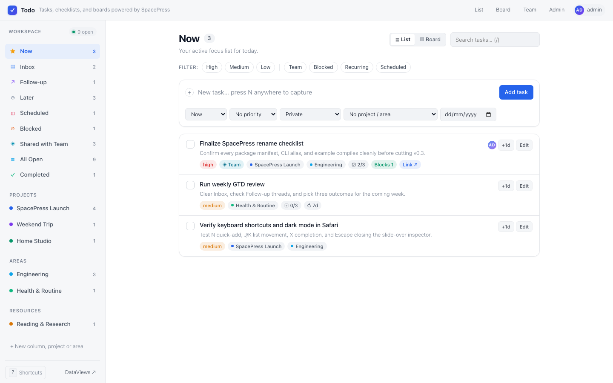
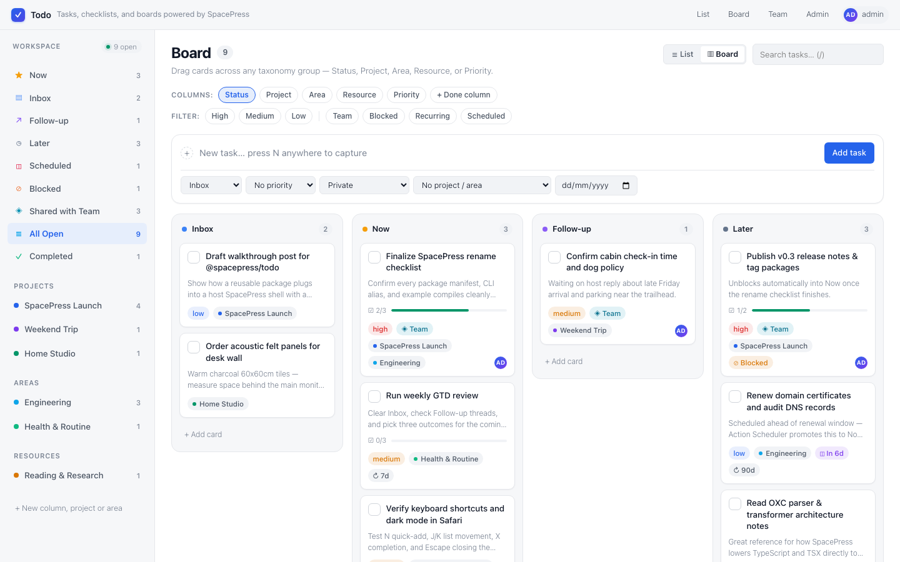
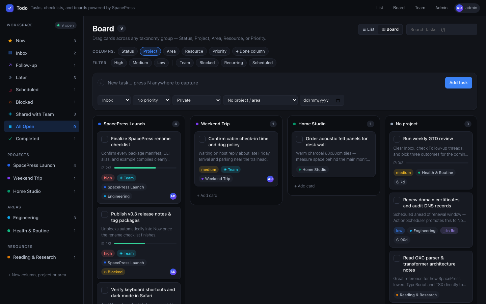
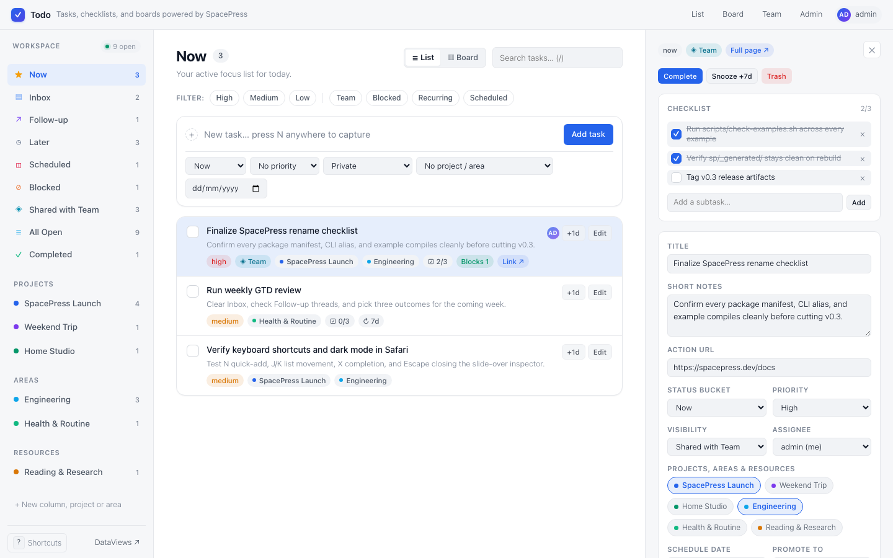
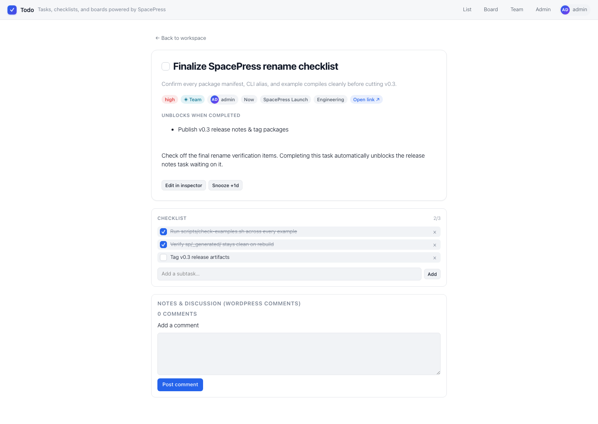
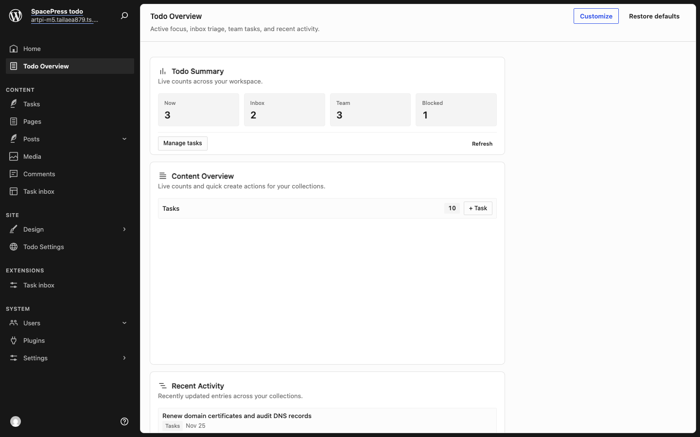

# SpacePress Todo Example

A full-stack personal & team task workspace built as a thin SpacePress shell importing the reusable [`@spacepress/todo`](../../packages/todo) package.

## What it demonstrates

- **Reusable module architecture:** [`packages/todo`](../../packages/todo) owns the `collection()`, hierarchical `taxonomy()`, global settings, and pure GTD/PARA/Kanban domain logic; `examples/todo` is the host shell that mounts it.
- **WordPress-native storage:**
  - `tasks` as a WordPress `collection()` with `revisions`, `softDelete`, `url: "/tasks/:slug"`, private-by-default or team-shared `access`, optional `assigneeId`, `repeater()` subtask `checklist`, self-referencing `blockedBy`, scheduling (`scheduledAt` + `pendingBucket`), and recurrence (`recurringDays`).
  - `buckets` as a hierarchical WordPress `taxonomy()` combining workflow statuses (`inbox`, `now`, `follow-up`, `later`) and PARA organization (`project`, `area`, `resource`) — any taxonomy group can also drive the Kanban board's columns.
  - Native WordPress comments (`<Comments for={task} />`) for task discussion and history, with live comment count badges.
- **List + Taxonomy-Driven Kanban Board:** switch seamlessly between **List** and **Board** views (`?layout=board`), group Kanban columns by **any taxonomy kind** (`Status`, `Project`, `Area`, `Resource`) or `Priority`, toggle an optional `Completed` column, drag-and-drop cards between columns, or add cards directly into any column.
- **Server logic & automation:** `mutation()` actions (automatically exposed via REST & WordPress Abilities), delayed Action Scheduler `job()` (`promoteScheduledTask`), and a 15-minute `cron()` safety sweep.
- **SpacePress Admin:** custom `adminScreen()` DataViews table, `adminWidget()` metrics card, and `adminDashboard()` at `/wp-admin/new/`.
- **Read-only anonymous demo + authenticated writes:** `examples/todo` opts into `anonymousRead: true` so visitors can immediately explore List view, taxonomy Kanban boards, filters, checklists, and task pages without a login wall; signing in unlocks quick-add, drag-and-drop, checklist editing, comments, and SpacePress Admin. (`@spacepress/todo` defaults to `anonymousRead: false` so real apps remain strictly private.)
- **Calm, keyboard-first UX:** progressive zero-JS `<form action={...}>` with `useFormState()`, `<Live>` regions, `"use client"` Interactivity API islands (`TaskCheckButton`, `LiveWorkspacePulse`, `ParaBucketPicker`, `ChecklistEditor`, `KanbanDragController`, `TodoShortcuts`), URL-addressable slide-over inspector (`/?task=<id>`), priority/flag filter pills, keyboard shortcuts (`N`, `/`, `J`/`K`, `X`, `Enter`, `Esc`, `?`), light & dark mode, and starter Markdown seed data (`seed: true`).

## Running locally

From the repository root:

```sh
npm install --prefix examples/todo
./target/debug/spacepress dev examples/todo
```

Open the printed URL and sign in with the local dev credentials (`admin` / `spacepress-test-admin`). Open `/wp-admin/new/` to inspect the SpacePress Admin dashboard and DataViews screen.

## Screenshots

| List Workspace (Light) | Kanban Board by Status (Light) |
| --- | --- |
|  |  |

| Kanban Board by Project (Dark) | Slide-over Inspector & Checklists |
| --- | --- |
|  |  |

| Full Task Page & Native Comments | SpacePress Admin Overview | Mobile (390px) |
| --- | --- | --- |
|  |  |  |
