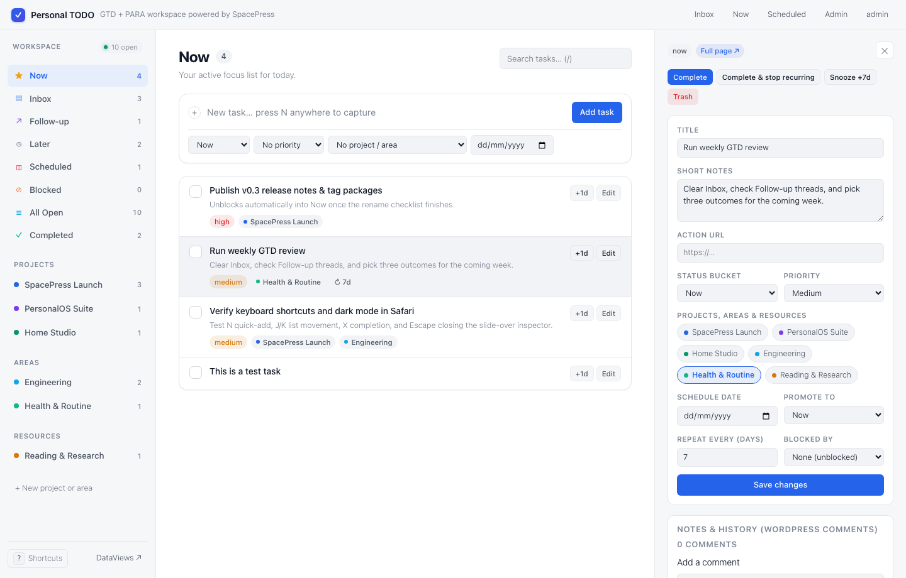
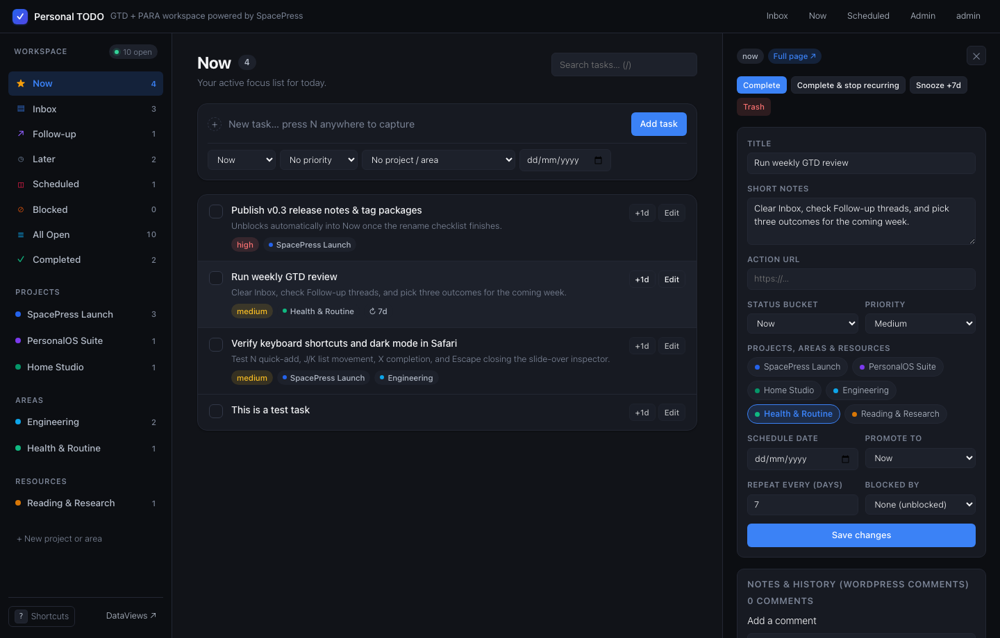
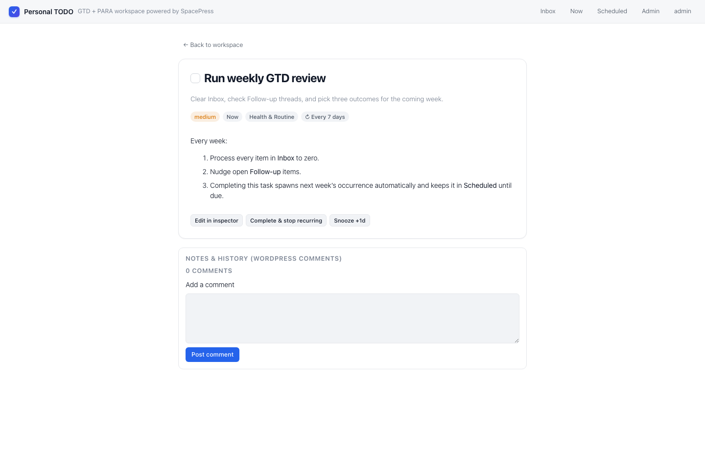
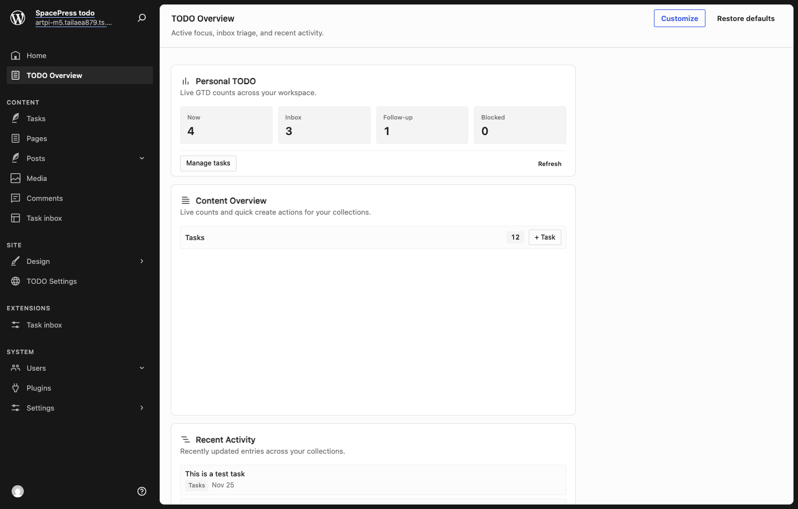
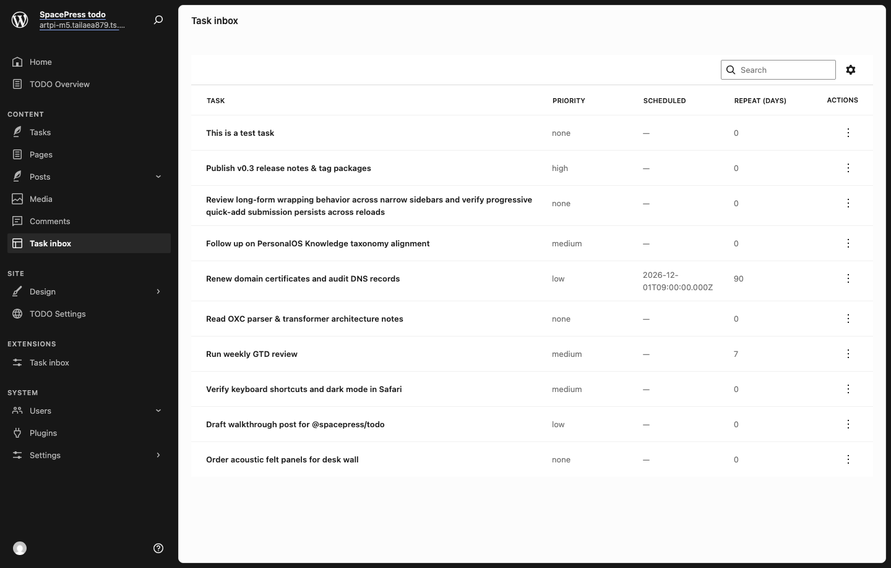
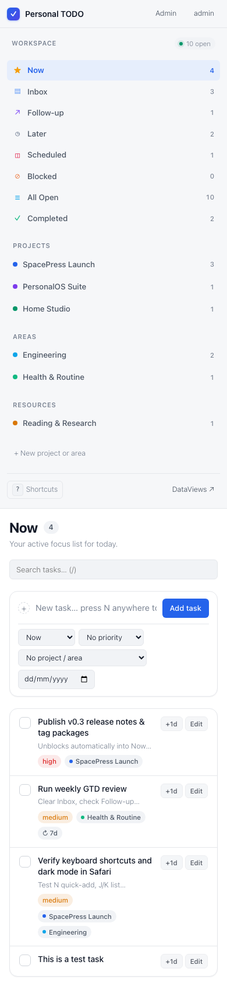

# SpacePress Personal TODO Example

A full-stack GTD + PARA task workspace built as a thin SpacePress shell importing the reusable [`@spacepress/todo`](../../packages/todo) package, inspired by [PersonalOS TODO](https://personalos.net/).

## What it demonstrates

- **Reusable module architecture:** [`packages/todo`](../../packages/todo) owns the `collection()`, hierarchical `taxonomy()`, global settings, and pure GTD/PARA domain logic; `examples/todo` is the host shell that mounts it.
- **WordPress-native storage:**
  - `tasks` as a WordPress `collection()` with `revisions`, `softDelete`, `url: "/tasks/:slug"`, owner-scoped private `access`, self-referencing `blockedBy`, scheduling (`scheduledAt` + `pendingBucket`), and recurrence (`recurringDays`).
  - `buckets` as a hierarchical WordPress `taxonomy()` combining GTD status (`inbox`, `now`, `follow-up`, `later`) and PARA organization (`project`, `area`, `resource`).
  - Native WordPress comments (`<Comments for={task} />`) for task notes & history.
- **Server logic & automation:** `mutation()` actions (automatically exposed via REST & WordPress Abilities), delayed Action Scheduler `job()` (`promoteScheduledTask`), and a 15-minute `cron()` safety sweep.
- **SpacePress Admin:** custom `adminScreen()` DataViews table, `adminWidget()` metrics card, and `adminDashboard()` at `/wp-admin/new/`.
- **Things 3 / Linear UX:** progressive zero-JS `<form action={...}>` with `useFormState()`, `<Live>` regions, `"use client"` Interactivity API islands (`useState`, `useLive`, `useMount`, `useEvent`, `useRef`, `sharedState`), URL-addressable slide-over inspector (`/?task=<id>`), keyboard shortcuts (`N`, `/`, `J`/`K`, `X`, `Enter`, `Esc`, `?`), light & dark mode, and starter Markdown seed data (`seed: true`).

## Running locally

From the repository root:

```sh
npm install --prefix examples/todo
./target/debug/spacepress dev examples/todo
```

Open the printed URL and sign in with the local dev credentials (`admin` / `spacepress-test-admin`). Open `/wp-admin/new/` to inspect the SpacePress Admin dashboard and DataViews screen.

## Screenshots

| Light Workspace | Slide-over Inspector (Light) |
| --- | --- |
|  |  |

| Dark Mode Inspector | Full Task Page & Native Comments |
| --- | --- |
|  |  |

| SpacePress Admin Dashboard | Admin DataViews Screen | Mobile (390px) |
| --- | --- | --- |
|  |  |  |
